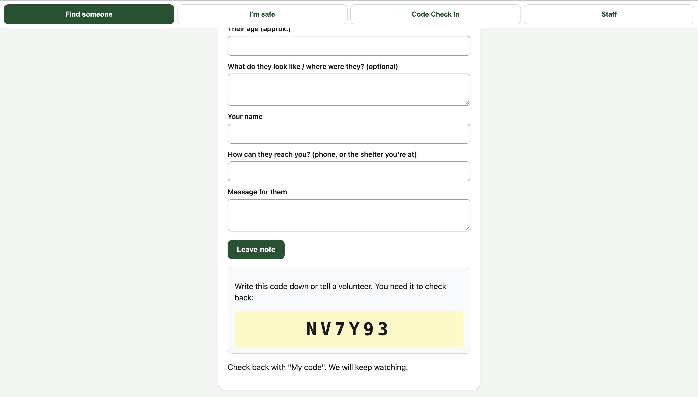
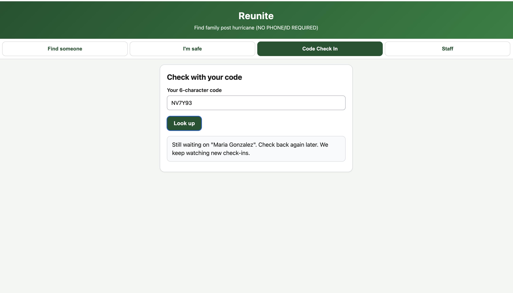
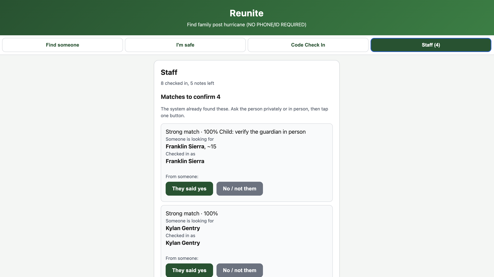
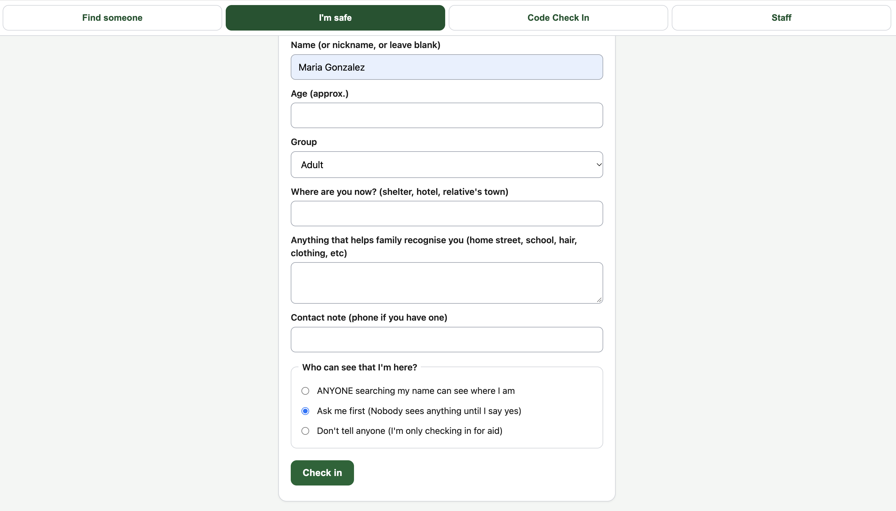

# Try It Out
**https://reunitetheseperated.onrender.com/**

**Staff PIN for the demo:** `2468`

## Overview
This project was created for my application to Dartmouth's DALI Lab when presented with a scenario where 400,000 people were evacuated in two days, thousands of families got separated, some people don't have a phone, ID, or even a desire to be found, and a database that balances all these user interests is needed.

**Reunite** was made to, well, help people do just that. It lets people check in at any shelter with just a nickname, get a short code, and be found by family only if they choose. Families are able to search by name or leave a note, with the system matching notes against check-ins automatically, including future ones. Shelter staff oversee the confirmation of matches with one tap. Importantly, NOBODY is revealed without their own yes.

### POV: The User
<table>
  <tr>
    <td align="center" width="50%">
      
       <b>Find someone.</b> Search by name, or leave a note that matches future check-ins.
    </td>
    <td align="center" width="50%">
      
       <b>I'm safe.</b> Put in your code (both finders & seekers) with no ID needed, and the seeker chooses who can see them.
    </td>
  </tr>
  <tr>
    <td align="center" width="50%">
      
       <b>Staff queue.</b> Matches are proposed by likelihood, then staff can easily confirm/deny with one tap.
    </td>
    <td align="center" width="50%">
      
       <b>Share selectively.</b> The found person decides whether to share. Nothing is revealed without a yes.
    </td>
  </tr>
</table>

### Key Features
* **Nickname-only check-in:** no ID, no phone, no immigration or personal documents requested
* **3 privacy levels per person:** open (searchable), ask me first (default), hidden (never matched or shown)
* **Spelling-tolerant matching:** "Gonzalez" matches "Gonzales" at 94%, plus an age sanity check
* **Notes for people not yet checked in:** the note matches automatically when they do
* **One-tap staff queue:** pre-matched requests with two buttons, "They said yes" and "No / not them"
* **Child protection:** children are never publicly listed, and only staff can approve contact about a child
* **6-character codes:** easy to write on paper, no accounts or logins
* **Anti-spam:** locked buttons, duplicate detection, per-device rate limits, honeypot field
* **Data minimization:** auto-delete after 30 days, and anyone can delete their own record

## The Pieces of a Full Picture Reunification System
Five categories of features (everything labeled "Built" has plenty of room for expansion, though):

1. **Check-in at every shelter** (can match across shelters/locations): **Built**
2. **Matching across shelters** (even with fuzzy names, ages, descriptions): **Built**
3. **Consent and privacy controls** (who may see whom): **Built**
4. **Staff review queue:** **Built**
5. **Future features during expansion** (a starting point, but not an exhaustive list): **Not built**
   * Per-shelter staff accounts with audit logs instead of one shared PIN 
   * Multilingual support since there's no guarantee that the 400,000 people in the region speak English
   * Photo matching, only with consent
   * SMS or email notification to the seeker when a match is approved
   * Offline-first app that syncs when connectivity returns, for shelters relying on paper-based systems or poor Wi-Fi

I built parts 1 to 4 to see if the system design could be **useful and safe** at a high level. The features in part 5 are the first ones I would consider adding with more time.

## Design

### The User(s)
* **Seekers:** Looking for family (often with no phone or ID) using a volunteer's device or a shelter tablet. They need a simple name search and a code they can write down.
* **People at shelters:** May be children, elderly, scared, or hiding. They need to check in without a real name and control who learns where they are.
* **Tired volunteers:** They need one short form that remembers the shelter, buttons that cannot be double-tapped, and a queue where the matching is already done.

### The Biggest Technical Choice: Which Part I Chose and Why
**The biggest tradeoff:** Consent-based matching. The hardest problem is ensuring that those who want to be found can be, without threatening those who don't want to be. A person who fled an abuser and a family looking for a lost child use the same system, so the default is that nothing is revealed until the found person says yes. As a result there **is an inherent tradeoff with longer wait times**, for however long it typically takes the found person to share their information. Despite this, the aim of this app is fundamentally to **ensure safety**, even if some efficiency is sacrificed as a by-product.

**Second tradeoff:** Simplicity over durability. Another natural constraint in this scenario is that the system has to work ASAP, in shelters with weak Wi-Fi and tired, non-technical volunteers. A database that needs setup, accounts, or a build step is one more thing that can break at 2 a.m. So I chose sql.js (SQLite running in WASM, saved to a single file) with no native build and zero configuration on Render's free tier. This causes **a tradeoff with data durability and scale**: sql.js rewrites the whole database file on every write, and Render's free disk is ephemeral, so records are lost on redeployment and heavy traffic would slow down. Despite this, the aim of this prototype is fundamentally to **prove the design is useful and safe**, even if some reliability is sacrificed as a by-product. In production this would move to a managed Postgres database with backups, which fits with the 30-day retention and delete-on-request already built in.

### Assumptions
* Every shelter has at least one shared device on weak wifi; survivors and seekers rarely have their own phone.
* Not everyone will give a name. Thus, the 6-character code is the only "identity" required.
* Staff are trusted but not technical, so one shared PIN is acceptable for a prototype (per-staff accounts are in the future list).
* A stated age is taken as true, since no ID exists. Anyone under 18 is treated as a child.
* 30 days is long enough to reunite families and short enough to limit the harm of stored data.

### Edge Cases Considered
| What could go wrong | What happens | Why |
|---|---|---|
| Someone fled an abuser | Default is "Ask me first"; "hidden" people are never matched | Nothing is revealed without their own yes |
| A child checks in | Never publicly searchable; contact needs the staff PIN | No handing a child to a stranger |
| Name spelling differs during matching | Fuzzy match plus age check, then a staff member confirms | Staff, not the algorithm, make the final call |
| Different people w/the same first name | Every name part must match; a lone first name never matches a full name | Fewer false alarms for tired staff and no leaks in search |
| Double-tap or flaky wifi | One idempotency key per form fill returns the same record | Two different people never share one code |
| A whole shelter sharing one IP address| Staff are exempt from limits; only failed code guesses count | Honest lookups never lock out a line of families |
| Someone guesses codes | Wrong guesses throttled; code space is ~1 billion | Brute-force guessing is just impractical |
| A stranger probes if someone is here | Leaving a note returns the same response either way | Searching cannot confirm presence |
| Harms of data lingering | 30-day auto-delete and self-delete | Data minimization |
 
### 60-Second Demo Walkthrough Example
Staff PIN is `2468`. The demo is seeded with fixed codes:
1. **Seeker view:** Find someone tab -> search "James Carter" (an open record appears, with his shelter).
2. **Seeker status:** My code -> `ANA222` ("Still waiting": Maria hasn't said yes).
3. **Consent:** My code -> `MARIA2`. Maria sees Ana's request and chooses "Yes" or "No".
4. **Staff:** Staff tab -> PIN `2468`. The Maria/Ana match is in the queue with a confidence badge.
5. **Child rule:** `DANI22` is a child; contact needs staff approval.
The free tier has a cold start (about 30-50s on the first load) and resets data on redeploy.
 
### Notes on AI Use
As a rule of thumb, AI did what I didn't want to do, couldn't do, needed help doing, or some combination of the three. 
1. **Quick Design Switches:** I could quickly create mockups of UI changes I was considering to evaluate the product in practice
2. **Idea Stress-Testing:** I handed AI my assumptions and the tradeoffs I was choosing to make, then asked it to push back on them as critically as possible
3. **A Second Set of Eyes:** I had a proofreader. Whether backend or frontend, having something else look over my coding choices is always helpful for catching mistakes
###
